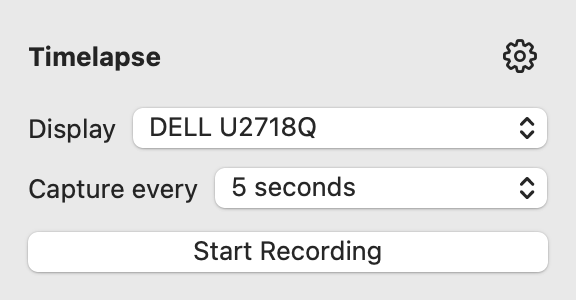
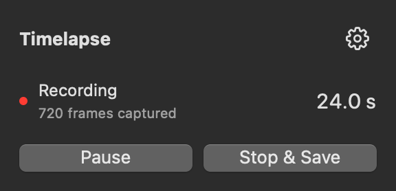

<div align="center">
  
  <h1 align="center">Timelapse</h1>
</div>

Timelapse is a small menu-bar app for macOS Sequoia (15) and later.
It captures your screen and creates a time-lapse movie from it.
You can configure the capture interval.

This is the native Swift replacement for my legacy [mre/timelapse-python](https://github.com/mre/timelapse-python) app.
No need to install any external dependencies like ffmpeg.
It uses Apple's native ScreenCaptureKit and AVFoundation frameworks to record your display and encode the movie.

<p align="center">
  
  
</p>
<p align="center"><sub>Ready to record in light mode; recording in dark mode.</sub></p>

## Goals

- Native macOS app with no external dependencies.
- Gets out of your way while you work.
- Ability to pause a recording and resume later.
- Configurable time-lapse interval and output resolution.
- Local recording only. No uploads.
- No temporary files.

## Getting started

[Download the latest release](https://github.com/mre/timelapse/releases/latest), unzip it, and move **Timelapse.app** to Applications.
The app supports Apple Silicon and Intel Macs. Builds are currently ad-hoc signed and not notarized; macOS may require approval in **System Settings → Privacy & Security** before opening them.

1. Start the app.
2. Click the Timelapse icon and choose **Allow Screen Recording…**. The setup window guides you through macOS permissions.
3. Choose a display and how often to capture a frame.
4. Click **Start Recording**. Use **Pause** and **Resume** whenever you need them.
5. Click **Stop & Save**, then **Show in Finder** to find your movie.

Movies are saved to `~/Movies/Timelapse` by default.
Open the **gear menu → Settings…** to change that.

### If macOS asks for permission

Enable Timelapse in **System Settings → Privacy & Security → Screen & System Audio Recording**.
The setup window checks for access automatically. If macOS asks, choose **Quit & Reopen**.

## Development

To build the app locally, you'll need Xcode 16 or newer with its command-line tools selected.

```sh
make app
open dist/Timelapse.app
```

## A few things to know

- Visible notifications and private windows can appear in the movie. Timelapse
  excludes its own windows.
- For safety reasons, you have to resume manually when you return. Timelapse
  doesn’t keep your Mac awake.
- Stopping or quitting finishes the current movie. Force-quitting, losing power,
  or running out of disk space can leave an unusable `.partial.mp4`.
- There’s no automatic deletion of old movies.

Unlike the legacy app, this version records a fixed display rather than following your pointer between displays.
Window and region capture, simultaneous displays, and audio aren't supported yet.
Let me know if you want any of those features.
